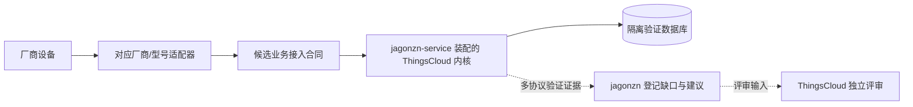
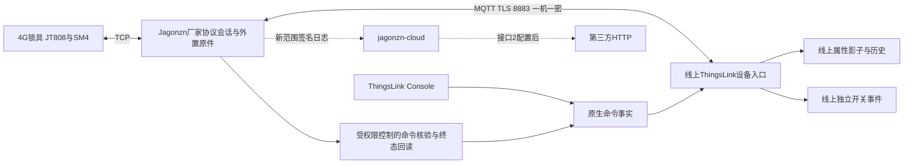

# 隔离验证部署、租户试点与平台合同演进

> 更新日期：2026-10-29
> 当前状态：独立service已完成内核装配及限定真机验证；公网平台核对及方案见[第9节](#9-thingslink公网平台接入核对与实施方案)，后继远程对接实现、验证与启用前置见[第10节](#10-jagonzn远程模式实现与启用前置)。远程代码已有本地候选，尚未创建线上锁具或切换实物入口。
> 第1～8节保留2026-09-24的隔离部署设计背景，其中“骨架/尚未集成”等为当时状态；当前实施和真机结果以[项目进度](PROJECT_PROGRESS.md)及第9节为准。旧隔离验证默认不回传平台的约束，不阻止负责人本轮新授权的公网对接设计；本轮仍不实施线上写入、提交、推送或部署。

## 1. 目的

用 jagonzn-service 作为隔离的设备接入验证部署，为 ThingsCloud 逐步建立可复用、受控、可验证的设备业务接入合同和协议适配扩展边界。烟感、智能锁及后续厂商设备可在验证部署中检验合同是否覆盖真实设备的身份、属性、事件、命令与设备结果闭环。

验证工作的产出是设备适配证据、能力不足记录和改进建议，由 ThingsCloud 项目自行评审是否修改及如何实施；jagonzn 无权修改任何 ThingsCloud 代码或数据库表，也不直接向共用内核回沉代码。验证实例收到的设备数据不实时转发到另一套 ThingsCloud。

**2026-09-24 负责人裁定：jagonzn 是能力使用方、设备适配与验证方、问题反馈方；ThingsCloud 是公共代码、数据库结构、合同和版本的评审及变更责任方。**此边界同样适用于 jagonzn 独立部署中的 ThingsCloud 副本，不能通过复制源码、修改 JAR、数据库函数或迁移绕过。jagonzn 可在自身项目开发适配代码，并通过已有受支持接口与配置使用平台；若需要新增平台能力，登记缺口并停止依赖该能力的实现。

### 为什么使用 ThingsCloud 租户模型和独立数据库

`jagonzn` 是当前 ThingsCloud 项目中的一个租户。以这个租户身份开发设备接入，可以直接验证平台真实使用的租户、项目、设备归属、认证授权、数据权限和设备业务链路，避免另造一套实验专用身份模型，导致设备适配在实验环境可用、进入 ThingsCloud 后却因身份或权限语义不同而返工。

jagonzn-service 独立运行并另建 `jagonzn` 数据库，是为了隔离现有 ThingsCloud 部署的数据与访问凭据，同时仍采用与所复用 ThingsCloud 版本一致的表结构和数据库迁移。这样开发者可以在受控环境中验证同一套内核数据模型和升级路径，不需要直接连接或写入 ThingsCloud 原数据库。运行负载与故障隔离还取决于数据库实例、Kafka/Redis 等中间件的部署、命名空间、权限及资源配置；仅创建另一个数据库不能证明这些隔离已成立。

整体目的可以概括为：**真实租户模型 → 独立同构部署 → 设备适配与闭环验证 → 记录不足和建议 → ThingsCloud 独立评审。**jagonzn-service 当前仍是 Spring Boot 骨架，尚未完成内核依赖和设备接入；上述说明是目标设计，不是已交付状态。

## 2. 术语与部署边界

| 名称 | 本文含义 | 边界 |
| --- | --- | --- |
| ThingsCloud 共用内核 | ThingsCloud 平台中可供装配复用的公共业务能力 | 公共代码、表结构、合同和版本由 ThingsCloud 评审维护；实际发布/库化能力按实施状态核实 |
| jagonzn-service 验证部署 | 独立运行的 jagonzn-service 应用及其基础设施 | 独立进程，另行创建名为 `jagonzn` 的数据库；与 ThingsCloud 原数据库完全隔离，但表结构/迁移按所复用 ThingsCloud 版本对齐 |
| ThingsCloud 租户 | ThingsCloud 数据模型中的 tenant/project/device 归属范围 | jagonzn 是当前 ThingsCloud 项目中的一个租户，其设备在本验证部署中按 jagonzn 的项目与设备归属进行认证和隔离 |
| 厂商适配器 | 某厂商或型号的帧解析、身份映射、字段映射、命令编码及协议确认处理 | 默认保持在独立适配边界；不会因为验证一次就自动成为 ThingsCloud 原生协议 |
| 公共业务接入合同 | 平台与适配器之间对身份、属性、事件、命令、结果及可靠性语义的约定 | jagonzn 使用已有合同，缺失语义形成建议；新增公共合同由 ThingsCloud 决定 |

“jagonzn 是当前 ThingsCloud 项目中的一个租户”描述平台数据归属；“jagonzn-service 是独立运行的验证部署”描述运行实例边界。验证部署另行创建名为 `jagonzn` 的数据库，与 ThingsCloud 原数据库完全隔离，但沿用所复用内核版本对应的表结构和迁移。

版本治理以 ThingsCloud 为源头：jagonzn-service、jagonzn-cloud 的应用交付基线及兼容的 Java/Spring Boot 版本向所选 ThingsCloud 版本对齐，service 内核依赖亦遵守该原则。若出现不兼容，调整或暂缓 jagonzn 侧集成并登记问题；不得修改 ThingsCloud 版本、覆盖 JAR 或增加平台迁移。只有 ThingsCloud 自行评审、实施并交付新的正式基线后，jagonzn 才能跟随该基线重新装配和验证。

当前代码状态必须如实区分目标与现状：架构文档记录 jagonzn-service 仍是基础 Spring Boot 项目，尚未引入 ThingsCloud 后端模块；因此“复用所有已交付能力”是目标架构，不代表当前已经完成依赖、装配或运行验证。模块存在也不代表其中所有规划能力已经交付。

## 3. 验证与反馈模型



候选处理流程：

1. 适配器验证厂商报文边界、设备身份、认证与项目归属，不让设备自报的 tenant/project 字段直接成为可信授权依据。
2. 适配器将厂商报文翻译为候选平台语义：当前属性、逐次发生的设备事件、状态变化、平台命令和设备报告结果；必要时保留经过脱敏的原始追溯标识。
3. jagonzn-service 通过已有受支持入口处理内核能够承载的事实，验证设备确权、持久化、命令路由、重复/重试及结果状态；设备事件等缺少入口的部分登记为平台缺口，不改表或伪装成属性绕过。
4. 使用真实设备或可复现样本覆盖成功、拒绝、重复报文、短连接、断线重连、迟到回复、重启恢复及协议异常。
5. 将 jagonzn 下不同设备协议的结果对照，整理共同缺口、已有能力覆盖和改进建议；厂商私有帧格式、厂家原因码及型号差异留在适配器。
6. ThingsCloud 根据这些记录独立评审，决定采纳、暂缓或不采纳；如其后续交付正式能力，jagonzn 再跟随该版本验证原缺口是否解决。

旧文中的“回沉”统一校准为“jagonzn 反馈，ThingsCloud 独立评审和演进”。反馈被登记或评审通过，都不代表能力已经实现；必须有 ThingsCloud 正式交付和 jagonzn 复验依据才能关闭受阻项。

## 4. 适配器与公共内核的职责边界

| 内容 | 建议归属 | 判断依据 |
| --- | --- | --- |
| 身份确权、tenant/project/device 权限、属性/事件/命令/结果公共语义 | ThingsCloud 共用内核合同 | 多适配器都需要且影响平台数据与安全一致性 |
| 消息受理、持久化、幂等、事件去重、命令生命周期、诊断和可观测性 | ThingsCloud 共用内核机制 | 需由平台统一定义和验收，避免每个适配器自行发明语义 |
| 厂商帧分拆、校验、加解密、私有身份字段、原因码、字段转换 | 对应厂商/型号适配器 | 随厂商和固件变化，不能假定跨设备一致 |
| 用户自定义编解码脚本、配置式数据流、插件装载、安全隔离和资源限制 | 待评估的扩展产品能力 | 未经设计冻结和安全验证，不开放任意代码执行或全量插件能力 |

一款设备适配成功只证明该设备/固件在所记录条件下可接入，不证明平台已支持所有 TCP、JSON、HEX、Modbus RTU、JT808 或任意厂家协议。兼容声明应精确到协议版本、型号、固件及测试范围。

## 5. 最小合同的验证范围

以下三类合同方向不同，不能互相替代：

| 合同 | 当前状态与用途 |
| --- | --- |
| ThingsCloud 原生设备线协议 | 已有[标准协议合同](../../.private/thingslink-docs/docs/device-integration/STANDARD_PROTOCOL_ACCESS.md)，约束 TC 帧、认证及属性/命令等；厂商适配不自动修改该合同 |
| 厂商适配器 → 平台业务接入合同 | 本文待冻结的最小合同，定义如何可靠交付设备事实；具体 API/DTO 和设备事件存储尚未交付 |
| 平台 → 外部应用公共集成合同 | 已有 [S14-R8 集成合同](../../.private/thingslink-docs/docs/delivery/S14-R8-integration-contract.md)，公共 Webhook 投递既定平台事件；不能据此推断任意设备事件可以上报 |

| 合同对象 | 需定义并验证的关键语义 |
| --- | --- |
| 设备身份 | 厂家标识到平台设备的可信绑定、项目范围、凭据校验、撤销、重置与重新绑定 |
| 属性 | 当前值/历史值、时间戳、单位、类型与物模型校验；属性快照不得替代逐次事件 |
| 事件 | 事件类型、设备/平台时间、事件唯一标识、顺序范围、重复检测、迟到/补传及持久确认 |
| 命令 | 命令 ID/幂等键、目标设备、参数、有效期、排队和重试范围、离线处理及授权边界 |
| 设备结果 | 平台受理、协议发送、设备 ACK、设备报告成功/失败、超时和结果未知的区分与关联 |
| 可靠性 | 持久接管点、重试与去重窗口、重连恢复、背压、死信/诊断及状态查询能力 |
| 安全与租户隔离 | 认证凭据不泄漏，设备不能自选 tenant/project；跨租户读写和命令操作均拒绝 |

本表是需求与验证清单，不能据此在 jagonzn 中新增 ThingsCloud 公共接口。现有合同不覆盖的内容登记到[平台能力不足与改进建议](PLATFORM_CAPABILITY_FEEDBACK.md)，由 ThingsCloud 评审。

平台受理不等于设备执行成功；设备 ACK 也未必等于物理动作最终成功。不同设备不能提供相同保证时，合同应标记能力差异，不得用含糊的统一“成功”状态掩盖。

IMEI 预登记能建立设备标识映射，但不能单独证明连接方持有可信凭据。烟感资料尚未证明其具备等同平台 secret 的认证能力；鉴权材料、可信传输或受控网关边界须按型号裁定，不能将“登记成功”写成“安全认证已通过”。无法在现有能力下完成的逐次事件路径保持受阻，等待 ThingsCloud 评审结果。

## 6. 版本、数据库和验证证据

- 每份验证记录关联 ThingsCloud 内核版本、数据库迁移版本、jagonzn-service 版本、适配器版本、租户/项目样本、设备型号与固件；同时记录源码 commit、未提交变更说明和实际制品 SHA-256。当前 `0.0.1-SNAPSHOT` 坐标不能独自标识一份可复现制品。
- 验证部署使用独立数据库；不得通过共享表、跨库直写或临时拷贝生产凭据建立回沉链路。
- 数据库表结构与迁移必须匹配所装配的内核版本。jagonzn 不新增或修改平台表、索引、函数、权限模型或迁移；缺少存储能力登记反馈。结构一致也不能代替 API、事务、幂等和命令语义兼容性验证。
- 对真实报文、凭据或个人数据脱敏后保存最小复现样本、预期解析结果、故障注入结果和验收记录；密钥不得进入知识库样例。
- 厂商特有的协议事实和已验证型号更新到设备调研记录；平台公共合同改进建议写入反馈台账，jagonzn 不代改 ThingsCloud 合同/ADR/进度；自身实施推进与验证结论更新 jagonzn 进度/实施记录。
- 不因单一租户或单一协议试点推断通用性。至少区分“适配器可复用”“合同字段共通”“运行时语义已由内核保证”三种结论。

## 7. 尚待设计冻结

以下事项须在各自相关实现前裁定；阶段门以[进度总览 §3](PROJECT_PROGRESS.md#3.%20当前阶段：基线核对与最小合同冻结)为准，不要求未来通用插件方案先于内核复用全部完成。本文件不擅自指定尚不存在的 API、DTO、数据库表、扩展 API 或发布流程：

1. jagonzn-service 获取已有 ThingsCloud 制品与迁移的路径、坐标和升级/回滚细节；缺少正式交付能力登记反馈，不由 jagonzn 修改内核实现。
2. 候选业务合同中 identity、property、event、command、device result 的最终字段、版本、持久受理点、去重和错误语义。
3. 明确 `jagonzn` 数据库的连接凭据、迁移执行角色、备份/恢复策略，以及该库仅供 jagonzn-service 验证部署使用的运维边界。
4. 厂商适配器装载位置、第三方代码信任模型、配置式解析与插件能力范围，以及签名、隔离、限额、升级和回滚要求。
5. 首个试点设备、准确型号/固件、真实设备与厂家测试协作条件、端到端成功定义。
6. 数据库与内核变更边界已由负责人裁定为禁止 jagonzn 修改，不再作为开放选项；设备事件等缺口按反馈台账等待 ThingsCloud 自行评审，相关闭环保持受阻。裁定记录见[四维审计 §4](DOCS_AUDIT_2026-09-24.md#4.%20设计冻结裁定记录)。

若设计材料与主架构矛盾，或实现所需字段、接口及归属规则仍缺失，应先按项目约定发起设计冻结，不通过实现细节绕开裁定。

## 8. 与现有计划的关系

本文件细化 jagonzn 作为隔离验证部署的职责与合同反馈路径，不改变 ThingsCloud 当前实施阶段、门禁、切片或优先级。ThingsCloud 的当前状态以[开发进度总览](../../.private/thingslink-docs/docs/PROGRESS.md)为准；当前标准接入能力以[标准协议接入合同](../../.private/thingslink-docs/docs/device-integration/STANDARD_PROTOCOL_ACCESS.md)为准。多协议候选排序见[多协议接入能力建设优先级](protocol-expansion-priority.md)。

## 9. ThingsLink公网平台接入核对与实施方案

### 9.1 本次结论与固定身份

2026-10-29按负责人“只核对、只修改jagonzn、暂不提交/推送/部署”的授权，通过既有SSH身份读取服务状态、发布清单、实际JAR摘要、非敏感配置、Nginx路由与Broker规则；公网仅做无凭据GET及TLS握手。未登录业务账号、读取设备秘密、创建线上设备、提交命令、发布MQTT消息或切换现有入口。此前本机真机通过不继承为本轮公网接入通过。

| 核对项 | 本轮实际结果 |
| --- | --- |
| Jagonzn源码 | `081c2911d52f6bd5201d907714a0113b2690db51`；开始核对时工作区干净 |
| 线上后端源码 | 发布清单为`260fa694876fce1b728ba87a4b91466765942aac`，发布名`overview-observed-20261028-1`；不能用本机ThingsLink后继HEAD推断线上能力 |
| 实际API JAR | `/opt/thingslink/backend/platform-api.jar`，SHA-256 `134784720605ce8f093ada23c0e14ea6e031feccca4400188bdaa0487c905fcd`，匹配发布清单 |
| 实际Access JAR | `/opt/thingslink/backend/device-access.jar`，SHA-256 `0a8ac9272ea3c051d0f887636d5dffc2e49fc8429452cf2c66fea5ed268e1c1b`，匹配发布清单 |
| 运行服务 | API、Access均为active/running，内网`8080/8081`的`/actuator/health`均HTTP200、UP；本轮没有重启 |
| 版本兼容 | 两个线上JAR中各18个公共模块，共36次摘要比较，全部匹配[service固定依赖](service-upstream.json)；此结论仅证明已列模块字节一致，不证明新远程模式已经可用 |
| 公网入口 | 官网、Console根路径与`/v1/`均GET200；管理面`/api/v1/auth/me`无会话401；设备HTTP入口在`api.thingslink.io:443`，MQTT在`api.thingslink.io:8883` |
| MQTT网络 | 主机名及CA校验通过、TLS1.3；未发送CONNECT，因此不认领设备认证、ACL、订阅、入库或命令结果 |
| 锁具TCP入口 | 云端6808仍为临时relay，经回环26808转发；它不是线上Access原生JT808监听。Access配置中TCP、CoAP均false，HTTP为true |

现有`Jt808ThingsLinkGateway`直接组合`DeviceAccessDeviceAuthenticator`、`DeviceAccessUplinkIngressService`、`DeviceCommandAccessReplyPort`；`Jt808ExtensionConfiguration`要求本机device-access角色、TCP下行消费者和PushRouter。这些是进程内Java端口，不是可通过替换baseUrl调用的远程API。现有鉴权身份、旧命令、属性历史及数据库属于独立测试部署，不能默认属于线上同名租户。

完整证据外置于`/Volumes/Samsung/Jagonzn/data/.private/deployment-session/public-platform-access-audit-20261029/`：`receipt.json`、`server-inventory.json`、`module-compatibility.json`、`server-health.json`、`public-readonly-probes.json`、`mqtt-tls-readonly.json`、`broker-rule-list.txt`及`broker-durable-rule.txt`。核对来源为固定提交源码及实际服务器，不以移动中的本机源码或历史文档替代。原始发现包含服务器无rg、Broker不支持`ctl eval`、首个TLS脚本缺导入；后继分别用Python、`rules list/show`和修正脚本完成只读检查，未改变服务器状态。

### 9.2 已有接口与实际可达范围

下表HTTP路径均相对于`https://api.thingslink.io`。设备面认证头为`X-TC-Device-Key: projectKey/deviceKey`和`X-TC-Device-Secret`，并要求线上设备明确启用对应协议；管理JWT、厂商SM4密钥、JT808六字节鉴权码不能替代平台设备凭据。

| 能力 | 线上版本已有合同 | 本轮核对及限制 |
| --- | --- | --- |
| HTTP属性上报 | `POST /device-access/v1/property/report`，稳定UUIDv7、发生时间、显式模型版本及payload；202仅可靠受理 | Nginx已放行，GET无凭据401；未发POST或验证真实凭据，不能据401宣称业务成功 |
| HTTP命令领取 | `POST /device-access/v1/command/claim`，返回commandId/commandKey/input/attempt/leaseExpiresAt；无命令204 | 已路由到设备认证，GET无凭据401；轮询只适用于线上HTTP绑定，不能用它抢取TCP/MQTT推送命令 |
| HTTP结果回复 | `POST /device-access/v1/command/reply`，返回202；未知归属404、冲突409 | GET无凭据401；202没有APPLIED/DUPLICATE明细，不证明平台终态SUCCEEDED |
| HTTP属性读取/运行日志/授时 | 源码分别有`GET /device-access/v1/attributes`、`POST /device-access/v1/runtime-logs`、`POST /device-access/v1/time` | 当前Nginx只允许前三条精确设备路径，三条均被兜底404；这是部署开放范围，不是“平台没实现”，本轮不修改 |
| MQTT认证与属性 | TLS8883，一机一密，用户名`projectKey/deviceKey`，QoS1、非retained；`tc/v1/{projectKey}/{deviceKey}/up/property/report` | 实际Broker健康且规则启用；需线上MQTT绑定、真实CONNECT/ACL及入库复验 |
| MQTT命令与回复 | 订阅`.../down/command/{commandId}`；向`.../up/command/{commandId}/reply`发送ACK/SUCCESS/FAILED | 有完整targetDeviceKey、commandKey、input、attempt，但下行正文无deadlineAt；必须另有可信截止校验，不能收到旧包就开锁 |
| 独立事件 | `.../up/event/{eventKey}`，严格messageId/modelVersion/occurredAt/params；正常事件摄取及历史GET均存在 | MQTT独立分流到事件事实，不伪装成属性；需事先发布事件定义。本次未发事件，不认领当前锁具公网事件验收 |
| 上行持久回执 | `.../down/uplink/receipt`，messageId/modelVersion/kind(PROPERTY或EVENT)/status=PERSISTED；补查发`.../up/uplink/receipt/query` | 固定源码已接线事务提交后回执及同设备Inbox补查；不是仅PUBACK。指南早期“无事件业务响应Topic”不覆盖此后继实现；本次仅核对，尚未实测本型号 |
| 命令事实回读 | `GET /api/v1/projects/{projectId}/devices/{deviceId}/commands/{commandId}`，控制权限下查询状态与attempts[].deadlineAt | 管理接口已有，需要当前项目控制权限。API Key的`/api/open/v1/devices/{deviceId}/commands/{commandId}`只查该Key来源命令，不能代查任意Console命令 |
| 标准TCP | 平台有TC帧/TLS合同、进程内认证/受理/回复/推送端口 | 当前云端TCP关闭；厂家JT808/SM4不能直接交原生TC解码器，不能用公网临时6808就绪推断已接入线上租户 |

依据为固定提交下`DeviceAccessHttpAuthenticationFilter`、`DeviceAccessHttpCommandController`、`DeviceAccessAccessPayloads`、`MqttCommandMessageEncoder`、`UplinkBusinessReceiptService`、`UplinkReceiptQueryHandler`、`EventUplinkKafkaConsumer`、`DeviceCommandAccessReplyService`及`DeviceCommandAttemptResponse`。该提交的MQTT raw消费者在属性标准化前专门分流事件，不能仅看到属性Normalizer就断言所有设备事件缺失。

### 9.3 推荐方案：Jagonzn保留厂家适配，公网通过MQTT接入



首选MQTT而非全HTTP，是因为线上已开放安全入口、推送命令、独立事件及上行持久回执；HTTP现有三条能覆盖属性和轮询命令，但没有相同的独立事件上报入口，且轮询与休眠窗口需要额外协调。本方案不让锁具改用MQTT：锁具仍用JT808/TCP，适配器负责向平台使用MQTT。平台记录的传输协议应真实标识为MQTT代理接入，厂家原件标识JT808_TCP，不伪造平台原生TCP会话。

Jagonzn继续保留独立内核模式；新增远程模式必须显式选择且互斥。已有`things-link.runtime.embedded=false`可关闭平台全量组件扫描，但还需在Jagonzn验证数据源、Flyway、Kafka、Redis及原本机转发Bean均未误启动；不能仅切一个配置就宣布隔离成立。远程启动只装配厂家协议、必要外置状态、远程身份及网络客户端，不连接线上数据库/Redis/Kafka，不部署18个模块到线上主服务，不改平台表、函数或JAR。

现有网关需抽为Jagonzn自己的能力接口，保留原内核实现，新增MQTT实现；会话中直接使用平台`AuthenticatedDeviceIdentity`及凭据代际的部分需分离。远程身份由明确预绑定与Broker真实认证建立，不凭空填平台credentialVersion，也不能将本地配置修订号冒称平台凭据代际。远程模式未通过验证前，旧独立模式保持可复验。

首台型号沿用已确认的厂家门磁业务判据。候选物模型至少包括`door_closed`布尔、`battery_percent`数值及`lock_state`枚举UNKNOWN/OPEN/CLOSED；`lock_state_source`明确MANUFACTURER_DOOR_CONTACT，没有门磁字段则保持UNKNOWN。事件键暂建议`lock_opened/lock_closed`，参数采用明确的原因码、门磁值及可选关联命令ID等标量；只有真实新报告形成的明确开关事实才发送，不能把授时、鉴权、派发意图或每次重复状态快照都变成开关事件。具体键与schema须在发布线上不可变模型前冻结，这些是待实现映射，不宣称现有平台已配置。

首轮只开放已有空参数`jt808_query`及经现场确认的单次`jt808_unlock`，关锁以真实门磁贴合上报判定，不安排额外关锁命令。设备休眠时不提前领取/派发，先获得同连接新鲜闭合基线再由平台提交；若查询仍不应答，保留固件限制，不用它替代基线或篡改历史超时。

### 9.4 仍缺能力、实施边界与负责人评审项

| 项目 | 归属与所需工作 | 当前结论 |
| --- | --- | --- |
| 远程网关及启动模式 | Jagonzn抽离进程内依赖，增加MQTT客户端、受控TLS/目标、连接恢复和默认关闭开关 | 尚未实现；不是新增平台接口的必然前置 |
| 线上设备与物模型 | 通过正式管理界面/API选定实际租户/项目，创建或核对DIRECT锁具、MQTT绑定、属性、事件与命令定义，再取得专用设备凭据 | 本轮未读取账号或建立线上身份；不能复制本机UUID，设备数量及套餐资格仍由平台正常判断 |
| 实物会话与在线 | 一把锁具唯一连接身份；只在有效JT808鉴权/活跃期间维持对应MQTT设备连接，休眠或断连时收敛，云不可达即禁止新控制 | 持久MQTT连接可能把适配器在线误作锁具在线，须在Jagonzn实现会话关联并验延迟/保活边界 |
| 上行持久队列 | 新鲜事实在外盘冻结UUIDv7、模型版本、发生时间及正文；接收匹配的PERSISTED再签收，断线补查/同正文重试 | 新队列须限定设备、序号、窗口和类型；沿用范围保护原则，不能转发全部历史。属性与事件使用不同稳定消息ID，避免跨kind碰撞 |
| 命令准入与截止 | 订阅成功、当前锁具活跃且有新鲜相反门磁基线；核验targetDeviceKey、白名单命令和空参数；核对线上同一attempt仍有效及deadlineAt后才允许一次物理写入 | MQTT正文缺截止时间是已核实合同边界。第一阶段可使用现有管理GET和受控当前项目控制身份核验；若限定仅设备凭据，则需平台评审受支持截止/命令查询合同，未交付前不开启远程开锁 |
| 命令终态与恢复 | 原commandId持久去重，发送未知不重开；门磁关联后冻结结果、重发同一结果消息；平台GET确认SUCCEEDED及证据相符才标记平台闭环 | MQTT PUBACK、HTTP202或重复吸收均不能直接标记平台成功；没有回读权限时保持待确认。管理凭据与设备秘密分开，不把个人密码写入配置；API Key自有收据不能越权代替Console命令查询 |
| 认证撤销与状态隔离 | Broker拒绝、断连、凭据轮换/撤销时停止新控制，复验旧结果和待上行的原身份；远程状态命名空间与本机测试完全分开 | JT808六字节token和平台secret不同。后续切换须有受控厂商token迁移/重新首绑方案；不直接复用包含旧identity/cmd/reply的整份状态文件，不让锁具恢复出厂作为默认步骤 |
| 事件与日志 | 按厂家门磁判据形成OPEN/CLOSED属性及明确原因的独立开关事件，预发布匹配参数定义；原始协议日志留在Jagonzn，cloud接口2仍按原合同处理 | 平台已有MQTT独立事件，不再笼统称“平台无事件”。原厂报文和所有日志不会自动变成平台标准事件，HTTP运行日志也不能代替业务开关事件 |

管理GET所需的是平台当前控制权限，不是无权限“只读设备token”；是否为公网网关配置这种受控主体，由负责人评审。需再次明确其最小项目范围、凭据存储/失效和刷新、每次控制前回读失败时拒绝发送。该权限不能被Jagonzn自造JWT、直写平台表或运维超级账号替代。即便前置GET成功，网络间隙仍非平台原子派发许可，首次联调应限定单命令、短时效、活跃会话，并将跨网络准入时效列为验证项；不能宣称完全复制进程内原事务保障。

本轮没有确认新的ThingsLink业务代码缺陷。HTTP三条诊断/读取路径被Nginx挡住属于部署配置范围，保持原状，不将它作为首选MQTT方案的硬前置。命令截止/终态查询的设备侧合同不足按[JPF-004](PLATFORM_CAPABILITY_FEEDBACK.md#6-jpf-004厂商协议适配与公共扩展边界)供负责人评审；本轮不自动申请平台改造，不改其实现。若后继真实调用出现状态机、权限或计费异常，先保存固定版本、请求、原结果和复现，再向负责人汇报，依赖项停止，其他独立项可继续。

### 9.5 分步实施及验收

| 顺序 | 具体工作与通过标准 | 当前状态 |
| --- | --- | --- |
| 1 | 固定线上JAR/源码身份、实际路由、MQTT规则及版本兼容，完成只读核对 | 已完成本轮限定核对；证据见9.1，不等于业务接入通过 |
| 2 | 在Jagonzn实现互斥远程模式及网关接口，验证不启动本机平台库/消费者，外置队列和凭据隔离；旧模式回归不退化 | 待实施 |
| 3 | 冻结物模型与属性/事件/命令映射、线上归属、设备凭据及管理回读授权；准备状态迁移和回退清单 | 待受控建立；本轮不创建线上资源 |
| 4 | 隔离环境先验真实Broker、属性/事件PERSISTED及补查、断线/重启去重、撤销和拒绝路径；命令过期/重复/未知不得重复动作 | 待实施和验证；不能用模拟响应代替真实运行时 |
| 5 | 公网先只接一台锁具的新状态与两条新开关事件，核对线上属性历史、影子与事件GET；无历史补交 | 待部署与线上写入授权；开始前保持控制关闭 |
| 6 | 命令截止/回读路径就绪后，现场确认并仅从线上提交一次开锁，实际门磁分离/贴合，核对原生SUCCEEDED、一次物理派发、OPEN/CLOSED及日志 | 待前置与现场配合；不靠5秒计时推断合锁，不伪造设备ACK |

后续部署方案应把厂家接收进程放在可持续运行的受控节点，明确是否继续保留`34.80.56.185:6808`；切换前先核对已有relay、会话和端口归属，不同时启用两个同身份MQTT客户端或两处物理发送器。生产数据库不合并本机测试库，旧日志与未知控制原件保留。第三方接口2不是平台接入前置，URL未定仍关闭；只需后续将本轮允许的新事件按原范围交给cloud。

本轮只形成方案和反馈，不实现上述远程网关、不启用公网设备身份、不修改服务器入口、不触发开锁，也不自动恢复已删除的定时监听任务。后继实施应逐项取得自身验证证据，不继承旧真机或模拟第三方通过范围。

## 10. Jagonzn远程模式实现与启用前置

### 10.1 本地实现范围

后继按负责人“依次连续推进”的授权，在Jagonzn实现远程入口、平台能力抽象、MQTT/TLS客户端、管理面只读核验、外置上行队列及结果回读；只增加Jagonzn源码、测试、示例和说明。ThingsLink依赖继续固定9.1的18个公共JAR，未复制或修改平台业务代码、数据库结构、函数或迁移；未替换既有运行中service或6808入口。

- [平台网关接口](../jagonzn-service/src/main/java/com/jagonzn/service/extension/jt808/Jt808PlatformGateway.java)与原内核实现分离。远程实现仍使用现有不可变身份DTO，但tenant/account/currentProject由真实认证me核对，项目OWNER与projectKey由正式项目列表核对，deviceKey/DIRECT/当前模型与MQTT配置分别读取正式接口，credentialVersion/configVersion严格匹配私有准备值；不以本地随机号、配置修订或IMEI冒称平台凭据版本。
- [独立远程启动入口](../jagonzn-service/src/main/java/com/jagonzn/remote/Jt808RemoteApplication.java)只显式导入远程Bean，不扫描原service或平台包。实际入口在Bean创建前校验互斥条件；内核embedded、旧JT808装配、旧cloud发送器或handoff开启均拒绝。排除数据源、Flyway、Redis、Kafka等自动装配；此入口不运行平台数据库迁移、规则消费者或原生下行消费者。原默认应用入口保留。
- [私有范围](../jagonzn-service/src/main/java/com/jagonzn/service/extension/jt808/Jt808RemoteSettings.java)使用0600外置文件，固定HTTPS/MQTT同主机目标、主体、真实版本、三处不同的session/outbox/journal目录、scopeId和新接收窗口。会话与队列首次须为空，重启沿用原范围摘要；原始日志同时核对明确目录及初次空序号。环境变量指向旧日志目录、目录替换、硬件/模型/属性映射/秘密指纹改变均拒绝，不导入旧控制记录或原58条历史。
- 属性与开关事件在外置队列冻结不同UUIDv7及正文。PUBACK不签收，仅匹配本设备Topic、messageId、modelVersion、kind和PERSISTED才落标记；回执丢失可补查，断线/重启重用原正文。范围内未签收事实可在原窗口之后继续重试，新事实超窗拒绝。容量有界，满后保留原件并拒绝受理，不静默删除。
- 原物理会话继续处理JT808/SM4。远程属性显式携带厂家门磁判据`lock_state/lock_state_source`；原因1/2与真实门磁一致时分别产生`lock_opened/lock_closed`事件，其他协议日志不转换成业务开关事件。没有门磁字段保持UNKNOWN，不根据电机延时推断锁舌位置。
- MQTT只在真实锁具握手取得平台认证与订阅后启用；旧会话退出不关闭新代次。换代次或远端断连清除待处理网络命令，使用clean session，不开启后台自动重连伪装实物在线；休眠主动断开对应MQTT连接。原始JT808失败在本地有界退避，Broker和平台的真实鉴权/预算不被替代。
- [命令核验](../jagonzn-service/src/main/java/com/jagonzn/service/extension/jt808/Jt808RemoteGateway.java)默认关闭，仅支持空参数`jt808_query/jt808_unlock`；核对原commandId、直连目标、当前状态、attempt以及管理GET返回的相同attempt的deadlineAt，过期/越权/其他设备/非白名单均不物理发送。最后仍由现有厂家会话检查新鲜相反门磁基线、唯一在途命令、UNKNOWN及持久去重，重复下行不增加物理派发。
- 结果保留原messageId、发生时刻、输出及证据，网络重试只重交结果。平台命令GET确认对应SUCCEEDED/FAILED/ACKNOWLEDGED与原输出（失败还核错误码）后才确认应用。未读到终态为`CONFIRMED_PENDING`；该期间后继真实关门仍关联同一已观察开锁，不能因为网络回读慢而丢失关门日志关系，也不能提前把平台任务记成功。

### 10.2 配置、建档材料与启动方式

[范围示例](../deploy/lab/jt808-remote-scope.example.json)全部为合成UUID、占位外盘路径及未来窗口，`controlsEnabled=false`；[模型准备示例](../deploy/lab/jt808-remote-model.example.json)包含DIRECT/CELLULAR_4G类型、4个属性、2个开关事件和查询/开锁命令。它们是待核对材料，不是已经执行的线上请求。必须先通过正式API或界面建立并发布匹配模型，核对设备实际绑定，再以真实ID和版本生成私有scope；不改已有已绑定型号或直接写平台表。

较早的只读准备轮已通过正式API核对用户给出的账号/租户/项目：项目名为“ESP32-S3 实机联调”，projectKey为`v9vskuyh`，账号为OWNER；当时设备0台、类型2个，未创建资源。原件`online-binding-preparation.private.json`与旧令牌作为该轮历史保留。后继用户指出控制台没有锁具后，已通过正常登录会话及正式管理接口补齐线上建档：新增专属`jt808_dm08_va`类型、4个属性、2个事件、查询/开锁命令，发布`1.0.0`并创建deviceKey为`862733073716824`的锁具设备；IMEI、MAC和型号保存为标签，MQTT接入已启用，一机一密只创建一次。设备列表回读为1台，设备业务状态INACTIVE、仍未连接实物；未提交设备命令或切换6808接收器。线上真实身份、配置/凭据版本及唯一一次返回的设备秘密保存在外盘`public-platform-device-enrollment-20261029/`的0600原件，不进入仓库；个人密码未保存。该轮首次客户端切项目遗漏刷新Cookie而返回401，补用平台正常Cookie会话后成功，属客户端调用修正，不认定为平台缺陷。

独立入口命令形状如下，路径及进程归属必须先核对，不以本条授权现在启动或切换公网入口：

```sh
JAGONZN_SERVICE_LOG_PATH=<本轮外盘日志目录> \
java -jar <已核对的service候选.jar> --remote-jt808 \
  --spring.config.additional-location=file:<本轮远程配置.properties>
```

```properties
jagonzn.jt808.remote.enabled=true
things-link.runtime.embedded=false
jagonzn.jt808.remote.scope-file=<本轮外盘0600范围文件>
jagonzn.jt808.external-root=<已核验外盘根>
jagonzn.jt808.crypto-file=<厂家私有SM4配置>
jagonzn.jt808.binding-file=<已核对远程项目与设备秘密的预绑定>
jagonzn.jt808.logs.directory=<与范围journalDirectory完全一致的专属0700目录>
# 本机默认仅回环16809/18082；切换前须核对占用，不复用当前6808反向转发。
jagonzn.jt808.bind-address=127.0.0.1
jagonzn.jt808.port=16809
server.address=127.0.0.1
server.port=18082
```

远程配置名与原application.properties分开，不需要数据库、Redis、Kafka、MinIO或平台JWT签发秘密。管理令牌只用作现有GET，首版限制当前租户项目OWNER；不自动登录、刷新或给其他账号扩权，令牌到期/权限撤销立即阻止核验及新控制，须重新取得受控短期令牌。生产TLS信任沿默认CA和主机名校验，不能沿用隔离测试CA或关闭校验。

当前远程入口明确拒绝原cloud自动转发开关，先外置保留原始日志。原独立内核模式的cloud接口2交付仍保留原实现与范围保护；远程模式如需同时启用这条出口，须另外完成当前新来源/身份/日志范围绑定，不能将旧签收标记或旧源身份直接继承。第三方URL仍未提供，不发第三方请求。

### 10.3 厂家鉴权码的离线迁移与回退边界

[离线迁移工具](../jagonzn-service/src/main/java/com/jagonzn/service/extension/jt808/Jt808RemoteStateMigration.java)只将六字节厂家token、非回绕serial水位及原件SHA256写入独立新session目录，不复制旧平台identity、上报、历史cmd或reply。新旧预绑定须为同一终端与MAC，并由同一私有SM4配置加载；默认目标scope必须关闭控制，明确授权单次控制测试时可通过`--allow-control-scope`显式允许控制范围，迁移内容和其他检查不变。工具独占源状态租约后再核对操作者预先指定的原件摘要，原服务运行、源摘要改变、未完成控制、未核对UNKNOWN或待确认回复均拒绝；UNKNOWN只读查询与已有现场核对原件的控制不被改写成成功。旧状态原始字节保持不变，非空目标不覆盖，失败后不自动重复执行。

下面只说明命令参数。只有后继明确授权停止旧接收进程并切换时，先保留旧JAR/绑定/状态/日志/转发归属清单，核对旧命令和当前锁住状态，再固定源SHA256及真实目标scope执行；当前运行中的真机服务不因此停止：

```sh
java -jar <已核对的service候选.jar> --prepare-remote-jt808-state \
  <外盘根> <远程scope.json> <私有SM4配置> \
  <旧预绑定.properties> <新平台预绑定.properties> \
  <旧session目录> <adapter-state.properties的SHA256>
```

迁移不联系平台或锁具、不生成新厂家token、不恢复出厂、不自动改变6808路由。下一次真实鉴权仍须通过平台管理核验和Broker设备认证。回退先停止新控制和唯一新接收端，保留新旧两份状态；只允许明确选定的一处接收器运行。同一token迁移不等于可以直接恢复旧文件后重发控制：新会话已使用的流水水位、任何新未知命令和原结果待确认必须单独核对，禁止水位回退、重演未知控制或用旧平台身份重交新记录。未形成该回退核对时保持控制关闭。

### 10.4 验证证据与剩余工作

原件统一外置于`public-platform-bridge-development-20261029/`，包括源码摘要、各次Maven日志、完整报告、外盘Lima物理落点、受控模拟配置和线上只读准备结果。

最终198项聚焦回归全部通过（0失败、0错误、0跳过），其中2项为实际隔离网络专项、5项覆盖离线迁移。已完成的验证包括：原内核模式协议/注册鉴权/门磁控制闭环与日志范围回归；完整远程Spring装配未创建DataSource/Flyway/Redis连接工厂/Kafka监听器/平台接入认证Bean；PUBACK与PERSISTED区分、同正文重试/重启、类型/窗口/身份冲突、目录替换、环境变量覆盖、凭据版本撤销、活跃MQTT连接下配置变更阻止排队上行和结果重试、命令过期/其他目标/尝试变化/终态拒绝和固定结果回读。最终数量与打包/实际JAR启动结果以本轮外盘`receipt.json`为准，不将较早通过报告继承到后继改动。

网络专项使用实际隔离EMQX6.2.3、真实TLS MQTT、真实HTTPS合同模拟端及合成SM4 TCP锁。完成注册鉴权、门磁基线、单条开锁帧、重复下行去重、OPEN/CLOSED、3条属性及2条事件的匹配PERSISTED、原命令GET终态确认及休眠断开；错误秘密与跨设备订阅被拒绝。这里的管理GET/结果状态由合同模拟端提供，不是线上ThingsLink运行时的命令或数据库验证，也不是实物锁新一轮动作。EMQX测试认证按[官方内置数据库文档](https://docs.emqx.com/en/emqx/latest/guides/access-control/authn/mnesia.html)配置，只用于本轮隔离容器。

首败均保留：远程装配最初以Object注入守卫造成Bean类型歧义，已改为专用类型；收紧硬件映射指纹后启动夹具漏填电量映射，已修夹具；镜像拉取因VM网络失败，线上镜像又为amd64，后继经宿主机官方Registry下载并核验arm64 manifest、压缩层及diffId，未修改daemon代理或线上容器；首次Broker缺node.data_dir，补齐拥有的测试配置；初选18884被原测试service占用，严格TLS拒绝了不同证书，后继预检空闲28993/28994并保留原进程；一次派发计数断言误把contact.serial计作另一物理命令，收紧为精确command UUID字段；后继发现重复门磁原件在命令结束后重建关联字段会冲突，已改为原子保存事件ID和首次冻结正文，并补充重放回归。没有关闭TLS或权限保护制造通过，也没有确认需改ThingsLink业务代码的问题。

| 后继工作 | 当前状态与前置 |
| --- | --- |
| 线上设备与模型建立 | 后继正式API建档及回读通过：专属DIRECT类型、1.0.0模型、IMEI设备、MQTT及一次设备凭据均已建立；设备INACTIVE，实物未连接，见10.2 |
| 真实平台网络纵切 | 线上身份已建立；待以新范围验证真实ThingsLink的属性/事件PERSISTED、重复/重启、撤销和管理读回；本地合同模拟不代替此项 |
| 厂商状态迁移 | 已按10.5在本机测试接收器间受控迁移厂家token及流水95；旧原件保留，没有复制旧身份、命令或历史日志 |
| 单次真机开锁 | 同地址临时入口已接本机远程候选，控制仍关闭；厂家与平台鉴权衔接待复验，本轮未提交或下发开锁 |
| 正式常驻与第三方 | 本机候选打包/软件验证不构成部署；常驻进程、入口切换、远程模式cloud交付及真实第三方合同分别取得授权和自身证据 |

### 10.5 真实锁具公网鉴权候选与现场等待

后继按负责人继续鉴权激活、状态及开关日志验证的授权，已用原正式接口核对线上同一账号/租户/项目、DIRECT类型、`1.0.0`模型和MQTT配置（configVersion为1、credentialVersion为2），命令列表为空；平台TLS证书和主机名校验通过，未用模拟MQTT登录把设备标成在线。

本机旧接收器PID61462的JAR、配置、状态、日志及回退命令已留存。旧状态中无待确认回复；11条UNKNOWN包含5条只读查询及6条已有独立现场核对的控制，原记录不改写。已正常停止该本机测试进程，通过离线工具将厂家token及流水水位95迁入全新session目录，未复制旧平台identity、命令、回复、属性或日志；迁移前后旧状态字节一致。随后在原本机`127.0.0.1:16808`启动已验证候选`bd71c2e7`，仅回环健康口18082，健康UP；控制关闭、版本探针关闭、cloud旧发送器关闭，session/outbox/journal均为本轮独立外盘目录。

入口初查发现6808临时socket已不存在，26808的既有SSH转发仍由原PID23975持有。服务器日志确认停止原因为既有4小时expiry定时器正常触发，属于测试入口租约，不是锁具配置改变或平台业务缺陷。已核对原归属和端口空闲，按原配置恢复同一6808→26808→本机16808测试转发及同样4小时租约；未改Nginx、云防火墙、线上应用JAR或业务配置。公网TCP可建立连接，不能因此认领设备鉴权。限定6808的短期抓包经SSH直接写外盘，不落服务器业务目录。

10月29日现场暂无法操作，因此该轮仅完成接收准备，未取得真实鉴权/状态事实。原件统一位于外盘`public-platform-physical-lock-20261029/`，不继承合成网络回执为真机通过。范围窗口只限制新日志交付，管理令牌是短期会话，后继操作前重新核验；它们都不修改锁具IP/端口或厂家鉴权码。

10月30日现场恢复后，已核对原接收进程、空队列、同一线上身份/模型及有效设备凭据；原管理令牌、窗口和临时6808入口均到期。后继使用新独立范围和短期管理会话，受控迁移同一token/流水95，恢复原测试入口；未轮换设备密钥、上传线上JAR或改变云规则。第一轮触摸唤醒已在公网捕获本IMEI的合法SM4 `0x0102`及后继`0x0100`，终端、校验与零填充均有效，但没有厂家下行应答。Jagonzn处理失败后，平台出现ONLINE及lastOnlineAt；不能据此认领厂家鉴权闭环或属性入库。

首因已确认为Jagonzn连接生命周期问题：原Paho同步等待上限3秒，CONNECT超时后未取消底层异步连接，连接随后迟到成功；Broker实际出现该设备`connected=true, subscriptions=0`，而本地未固定认证身份、原始日志/上行队列为空。已关闭该拥有的半连接接收器，并用Broker只读列表确认残留会话消失；不是通过放宽平台ACL或伪造厂家应答解决。

Jagonzn修复包括：CONNECT与SUBACK均成功后才标就绪；失败连接强制取消和关闭，后继创建全新客户端，旧客户端回调不能影响新实例；CONNECT/SUBACK等待上限8秒、套接字连接5秒，正常发布仍限3秒。管理核验中的5项独立GET改为并发，设备类型读取仍依赖真实设备响应；未缓存、跳过主体/权限/模型/版本核验。新增4项MQTT生命周期回归及1项并发核验回归，203项聚焦测试和实际隔离TLS网络专项全部通过（0失败/错误/跳过），18个公共模块仍与固定制品相同。隔离测试Broker已停止、卷和原件保留。测试模拟管理端的PERSISTED仍不代替真实公网入库。

修复后的候选于10:41收到真机`0x0102`并完成厂家鉴权，MQTT连接及订阅就绪；随后真实`0x0200`上报门磁贴合、电量100%，平台影子及属性历史读回与上报一致，原PROPERTY消息取得PERSISTED。首条设备发生时间比服务器接收时间早约4小时57分，随后设备发起`0x040F`授时请求，服务端发送`0x840F`；没有收到明确的授时应答，不能仅凭发送认定授时成功。

10:50现场触摸唤醒并实际分离、贴回门磁后，本机收到两条新`0x0200`：门磁分离对应OPEN，贴合对应CLOSED。两条原PROPERTY消息均取得PERSISTED；平台历史按各自messageId读回两组属性，与首条共12条属性事实，最终影子为门磁贴合、CLOSED、电量100%。新报文设备发生时间分别比接收时间早约11秒和6.5秒，已回到本轮时段，但延迟可能包含设备缓存及传输时间，不能单凭该差值断言锁钟已准确。两条新报文厂家原因码均为15，按既定适配规则保留为`ALARM_REPORTED`并上报状态，不伪造原因码1/2的开关锁事件；本轮未执行物理开锁，平台事件列表为空不代表已验证开关锁事件。

收尾管理读取曾返回HTTP 429、业务码10029；本轮Jagonzn空闲时每秒并发核验管理接口可能触发或加剧限流。已停止本机旧候选以结束请求，保留三条PERSISTED和原始日志；随后在Jagonzn增加空闲无待处理消息时跳过管理GET、失败时2至30秒有界退避，保留原消息及同一ID，实际处理前仍完整核验权限和版本。205项聚焦软件及隔离TLS网络测试通过（0失败/错误/跳过），18个公共模块与固定制品一致。最新限流修复候选已在本机健康启动、控制关闭，未再作真机复验；上述真机事实来自此前已验证的连接修复候选，两者证据分别保留。

平台命令历史还可见三条本轮开始前的TIMED_OUT记录，保留原状态，不补发或推断其物理结果。本轮没有提交开锁命令。独立开关锁事件、平台命令闭环和远程模式交付cloud仍待后续专门验证；本机临时入口及短期管理令牌需在后续操作前重新核验。新原件位于外盘`public-platform-physical-lock-20261030/`，首败pcap、平台读回、Broker会话和各候选均保留。本轮尚未确认新的ThingsLink业务缺陷；未提交、推送或部署线上服务。

后继负责人授权最新候选进行一次真机远程开锁、自动合锁及命令/日志闭环。已核对用户现场锁舌伸出、门磁贴合，线上设备凭据及模型不变，历史命令无非终态记录。为限制物理动作，Jagonzn新增范围内单一开锁命令ID持久占位，重放仅允许原ID，新的第二个ID被拒绝；离线迁移到允许控制的范围需要显式参数`--allow-control-scope`，不会因此联网或发命令。207项聚焦测试及隔离TLS网络测试通过（0失败/错误/跳过），18个公共模块字节一致。

已保留上一范围日志/签收及原状态，仅迁移厂家token和流水到全新的本轮范围；本机候选健康UP，专属抓包及单次守候程序已就绪。守候程序只在本轮收到新鲜的门磁分离→贴合基线后，使用唯一幂等键向正式平台POST一次开锁；先保存原请求，未知结果不重试，最多等待5分钟。已通知现场按基线、观察锁舌缩回、再实际分离/贴回门磁的顺序操作。当前没有收到本轮真实报文，也未提交开锁；真实动作、平台终态、独立事件和新日志均待现场结果。原件保存在外盘`public-platform-physical-lock-20261030/single-unlock/`，未改平台业务代码、提交、推送或部署。

守候首轮因未收到现场报文超时，未创建或发送请求；负责人要求重来后，已核对原请求、状态及平台无新增非终态命令，更新管理会话并启动新的单次守候。第二轮现场说明为唤醒、门磁分离约5秒再贴合，等待期间未见开锁，随后又分离约2秒并贴合。接收端记录多条门磁状态，前两次闭合的设备时间分别早于接收时间约181秒、10秒，未满足同会话5秒新鲜基线；因此守候没有提交POST。操作结束时已主动停止本轮守候，核对没有原请求、发送开始标记或响应，平台命令列表相对操作前没有新增项。限定6808的完整抓包中，目标设备有有效SM4上报和`0x8001`应答，没有`0x8500`下行；不能把观察到的任何锁舌动作归因于本轮远程命令。原始记录保留在`single-unlock/`。

服务器最后接收到的`0x0200`流水8解密显示门磁贴合，但该帧未获得`0x8001`应答且没有形成日志；平台最后读回的门磁状态仍为OPEN。现场随后确认磁铁贴合、锁舌伸出，属于不同时间点的证据，不据此伪造平台闭合记录。锁具多次请求授时，现有记录未证明成功应答；时间陈旧与最后报文处理失败原因仍需核查。真实远程开锁、自动合锁、事件和命令闭环均未通过，禁止把这次操作或以前的实机结果当作本次成功。

后继对Jagonzn管理读取增加脱敏HTTP状态诊断后启动新本机候选；本轮11项相关测试通过，候选与此前207项全量聚焦测试的制品分别记录。一次仅诊断门磁操作的OPEN、CLOSED上报相对设备时间延迟约2.6秒、2.9秒。再次唤醒后，11:47:43完成鉴权、11:47:44发送授时，现场第一轮分离、贴合的服务接收时间分别为11:48:04、11:48:11，闭合发生时间与接收时间相差约1.9秒，满足新鲜基线；授时应答仍未确认。

**本次门磁事件未关联的代码根因已复现。** `Jt808Session.dispatch`保存首次已验证attempt的`deadlineAt`到`cmd.<id>.expires`。`expire`在维护或处理新报文时，将越过该期限的SENT/ACKNOWLEDGED转为UNKNOWN；`Jt808DoorContactConfirmation.pending`不包含UNKNOWN，故关联器找不到唯一在途命令。平台重试同一commandId时，`Jt808Session.owns`因原ID已有state直接拒绝，不重复物理下发，也不刷新原expires。因此平台第二次尝试尚有效，不等于本地关联窗口仍有效；这是Jagonzn自身等待生命周期与平台重试生命周期之间的行为差异，本轮未发现需交平台修复的业务缺陷。

| 本轮事实（北京时间） | 对关联的影响 |
| --- | --- |
| 首次命令deadline：11:48:37.526590 | 后继本地过期检查将原命令转UNKNOWN；不是从TCP发送完成后重新计20秒 |
| 第二次平台尝试：11:48:38.212017至11:48:58.212017 | 同ID不再物理发送，本地expires仍是首次deadline |
| OPEN：发生11:48:52，服务接收11:48:53.858438 | 设备时间仅早1.858438秒，原因1、流水5均符合；但比首次deadline晚16.331848秒，找不到待确认命令 |
| CLOSED：发生11:48:57，服务接收11:48:58.809915 | 设备时间仅早1.809915秒，原因2、流水6符合；此前没有成功关联OPEN，`recentUnlock`为空，不能补同一命令的关锁关系 |

本次两条上报不是因5秒新鲜度、缺少门磁属性、流水倒序、原因15或平台事件入库失败而失去关联；平台事件入库较本机接收稍晚也不是首次deadline已过的原因。门磁报文不携带commandId，不能仅凭平台当前仍有重试而追认属于该命令。新增两个回归按上述相对时间复现：原20秒deadline加同ID第二次尝试时，仅一帧物理派发、两条无关联日志、零结果回复及UNKNOWN；对照用首次60秒deadline且其余报文时序相同，可关联一次成功和后继关锁日志。两类测试仅在隔离夹具执行，不调整线上模型或历史终态；连同远程去重共22项测试通过，0失败/错误/跳过，产物在外盘`timing-investigation-build/`。

后续Jagonzn改进应区分“不可再次物理派发”和“是否仍可等待原动作结果”：同ID、同身份且平台当前attempt有效的情况下，评审是否只续接观察窗口；写入未知、过期后重连、旧报文或其他命令不得借此重新执行/追认。该行为尚未实现，本轮不借对照测试认领修复。为什么在网络收到`0x8500`后约33秒才收到原因1上报，当前协议记录和第一轮现场描述尚不足以区分固件延后生成、执行延迟或现场时序，须后续用严格分开的基线与命令后门磁操作验证。

11:48:17平台接受唯一命令`01a18aec-31f6-736d-bfc0-32acb43d1694`，首轮deadline为11:48:37；11:48:19适配器记录一次下发意图并标记SENT，11:48:20抓包协议头显示一条`0x8500`（流水125），随后收到TCP确认。抓包检查只解析未加密帧头，未宣称本轮离线解密及校验；TCP确认也不是协议执行应答。平台对同一命令做了三次尝试，最终均超时；适配器该命令只有一条派发记录，抓包帧头只发现一次`0x8500`。

11:48:53和11:48:58服务分别收到原因码1的OPEN和原因码2的CLOSED，设备记录时间为11:48:52和11:48:57；两条独立事件取得PERSISTED，平台事件接口读回`lock_opened`及`lock_closed`，影子最终为CLOSED。它们均晚于首轮deadline，本机原命令为UNKNOWN，平台最终为`TIMED_OUT/RESPONSE_TIMEOUT`，不得把事件或TCP确认改写为命令SUCCEEDED。现场说明仅执行第一轮门磁分离、贴合，其间观察到锁舌缩回、伸出；第一轮基线闭合发生在命令下发之前，不能将其锁舌动作归因于本命令。后继原因码1/2上报为何在现场未做第二轮门磁动作时产生、其与开锁帧的关系，以及20秒命令期限是否适合此设备，均需进一步核实；当前不能以延长时限代替新鲜性与可靠关联证据，也未确认ThingsLink业务缺陷。外盘保留命令读回、事件/影子、日志及抓包快照；未发第二条命令、未改平台终态或重放历史。

### 10.6 同命令重试仅续接结果等待

按后继修复授权，在Jagonzn增加独立`resumeResultWait`路径。远程网关仍先读取平台同命令当前attempt，核对设备、身份、命令及空参数、非终态、attempt编号和未过期deadline；后继尝试先交当前TCP会话续接。续接入口没有网络写入器，不分配流水、不重建基线、不追加物理派发记录。未续接的原ID仍由`push`持久去重拒绝；尚未物理发送的新ID仍须全部原准入与基线检查，不因attempt大于1而绕过。

会话只允许原开锁记录在同连接、同凭据代际、无其他在途控制、无人工结案或失效证据时续接。新attempt必须递增且deadline严格延后，整个等待不超过原发送后300秒；身份核验完成后再读取时钟检查期限，核验期间跨过deadline则拒绝。UNKNOWN明确区分`RESULT_WAIT_EXPIRED`、`WRITE_UNCERTAIN`和`PREPARED_UNCERTAIN`；仅前者可恢复此前SENT/ACKNOWLEDGED。旧记录缺少新元数据、重连/重启、休眠、凭据变化、原结果已确认、设备失败、其他命令、人工核对或过期空档已观察到动作均拒绝续接。

原发送时间、协议流水和首次deadline保持可查，最新attempt、续接时间和新deadline落盘。已过期后恢复时，证据须在续接之后生成并接收，仍受原5秒新鲜度、流水递增、唯一命令和厂家原因码约束；不追认空档报文，也不把旧日志补关联。正常结果中增加`command_attempt`和`confirmation_deadline`以供核对；平台确认SUCCEEDED前本地仍为CONFIRMED_PENDING。续接日志明确`physicalDispatch=false`。

软件回归包含原真机时间间隔续接成功、重复/倒退尝试拒绝、ACK保留、总时限有界、设备失败、写入未知、人工核对、重连、凭据/身份不符、其他在途命令、旧/重复报文和空档动作拒绝。本机TCP测试经真实SM4注册鉴权和一条开锁帧，再用核验的第二attempt续接，确认套接字没有第二条下行；新门磁OPEN产生唯一结果消息，模拟管理终态读回后本地成功，后继CLOSED仍只上报事件。该测试管理面与MQTT使用合同夹具，不能认领公网平台或真机已修复；历史11:48命令及两条事件不改写。

最新候选215项JT808/命名空间聚焦回归通过，0失败、0错误、0跳过，包含上述本机TCP测试；打包成功。测试与候选在外盘`public-platform-physical-lock-20261030/wait-resumption-deadline-checked-build/`，未替换正在运行的接收器。真机复验前须重新核对短期凭据、范围和入口，建立新鲜基线；服务器下发后才能进行第二轮门磁动作。真实动作后的原因码1/2上报延迟仍需此次联合复验确认。

后继现场复验已用上述候选替换本机测试service，健康UP并核对公网6808入口；原未知命令按现场确认的当前锁住状态导入独立核对记录，保留原UNKNOWN及平台超时，仅迁移厂家token和流水，未迁移历史命令或日志。新范围只允许一个开锁命令ID。预检发现前次复验之后另有一条开锁和一条查询平台命令均超时；本机旧状态只有此前已知开锁ID，且旧范围占位只允许该ID，无法确定额外开锁任务来源或是否由其他接收器处理；原件保留，未把它们归属到本轮。

本轮15:13完成鉴权并发送授时，15:14:55收到新鲜闭合基线；15:15:04本机发送一次开锁，限定抓包的协议头显示一条`0x8500`。现场确认锁舌缩回后实际拿开磁铁再贴回，锁舌最后伸出。服务记录原因1 OPEN和原因2 CLOSED，均关联命令`01a18ba9-7a84-7e13-b7f3-22d3af261e2e`；平台读回SUCCEEDED及同命令门磁证据，`lock_opened`、`lock_closed`事件已入库且各有PERSISTED，影子CLOSED。协议ACK未收到，结果仍明确标注门磁判据及独立锁舌位置未知；抓包仅解析协议头，未宣称离线校验正文。

此次平台首个attempt即成功，实际没有产生平台重试，因此真机不能证明重试续接及重试不重复发送；该路径目前仅由上一轮软件回归与本机TCP合同夹具验证，历史超时未改写。公网重试路径仍待有自然重试的新一轮有界复验，不能为制造重试而伪造平台下行或延迟现场动作。原件在外盘`public-platform-physical-lock-20261030/wait-resumption-field/`；本机接收器保留运行，范围到北京时间16:05:26，临时公网转发定时器到16:24:39，时间到期不代表正式常驻部署。

后继自然重试复验另建独立范围，仅迁移厂家token及流水。15:28本轮一次开锁的现场反馈为锁舌缩回、实际分离并贴回磁铁、锁舌伸出；平台命令`01a18bb5-e698-728a-a9b5-cbed82ee9647`首个attempt即SUCCEEDED，抓包帧头只见一次`0x8500`，因此真实重试再次未发生。服务器本轮记录两条原因1 OPEN；平台读回两条`lock_opened`，没有本轮`lock_closed`，影子仍显示OPEN。

15:28:45网络收到流水7的`0x0200`，用现有厂家SM4解码器核对校验有效、门磁CLOSED、原因2、设备发生时间15:28:41；处理该帧时Jagonzn管理读取设备类型遇HTTP 429，`FRAME_PROCESS`失败并断开连接，因此没有该帧的正常日志、事件或成功应答，不能用现场或抓包数据伪造平台闭合。现场随后保持磁铁贴合只唤醒一次，15:31新连接鉴权成功，有限观察期内未见该闭合帧重传。HTTP 429是实际限流事实，不能仅凭它认定平台业务缺陷或断言Jagonzn请求是唯一原因；应继续排查Jagonzn密集上报期间的管理核验请求与失败恢复，保持撤权、身份和凭据校验，不绕过准入。证据保存在外盘`public-platform-physical-lock-20261030/natural-retry-field/`，本轮未更改历史命令或平台影子，未新增确认的平台缺陷。
